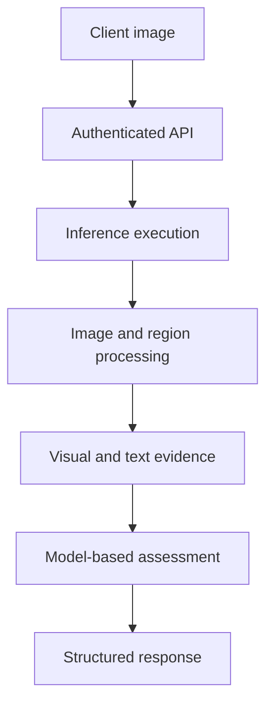

Spec-AI is a commercial image-analysis project that evaluates visible product packaging against authentic reference examples. This article discusses **general engineering patterns** and deliberately excludes proprietary scoring rules and model parameters.

## Why a multi-stage pipeline?
A single classifier is not always sufficient when the evidence includes packaging appearance, visible text, and object geometry. A modular approach makes it possible to inspect different sources of evidence and handle missing or low-quality inputs explicitly.

## High-level processing

The reviewed implementation uses FastAPI, segmentation, OCR, a shared visual feature extractor, brand identification, and product-specific anomaly assessment. Its API can execute directly or dispatch work through Celery and Redis. In the configured worker mode, the HTTP request still **waits for the completed task**, so this is not a non-blocking submission API.

## Model lifecycle
Model files are managed separately from application source through DVC. A central engineering concern is **artifact compatibility**: changing a feature extractor can invalidate downstream embeddings and anomaly models unless those assets are rebuilt together.

## Deployment architecture
The repository contains a GPU-oriented Docker deployment workflow with GitHub Actions, a container registry, DigitalOcean, and DVC-managed model assets. This is evidence of an implemented deployment configuration—not proof that every deployment succeeded or that the service meets a specific availability target.

## Lessons and open engineering work
- Readiness checks should verify meaningful inference capability, not only web-process startup.
- Model-asset synchronization should fail safely when required artifacts are missing.
- Queued inference should have explicit timeouts and clear client-facing execution semantics.
- Model evaluation must use representative held-out samples; a similarity score is not automatically a calibrated probability.

No accuracy, throughput, or latency figures are presented without independent measurement.

[View the Spec-AI project overview](/projects/spec-ai.html).